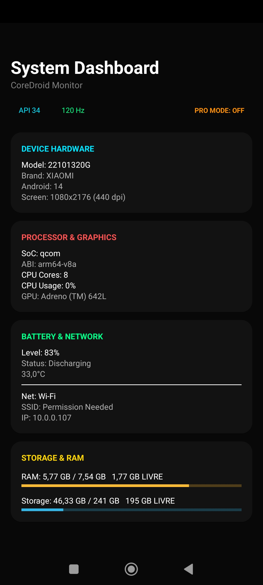
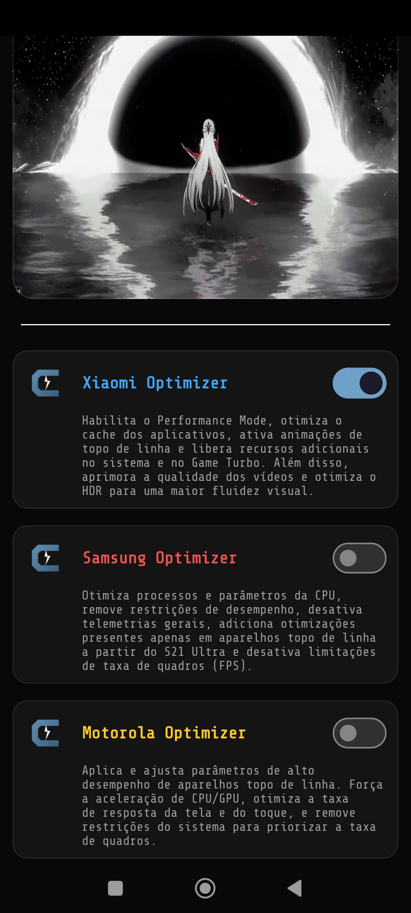
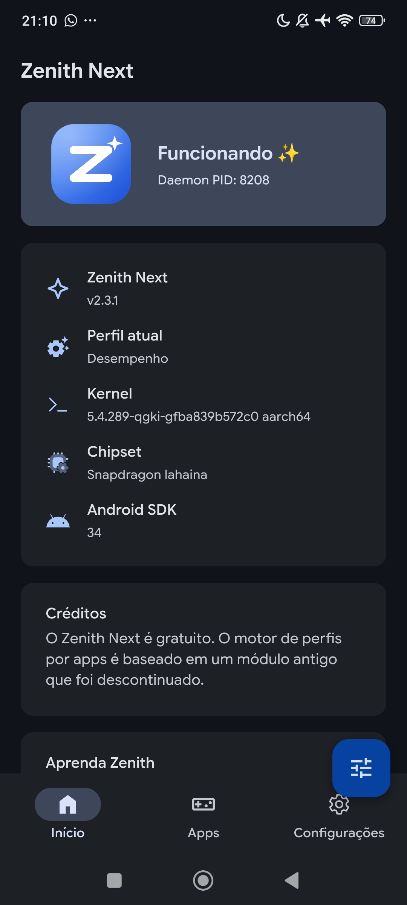
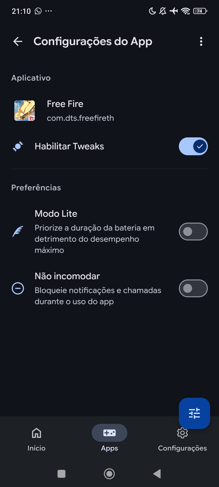
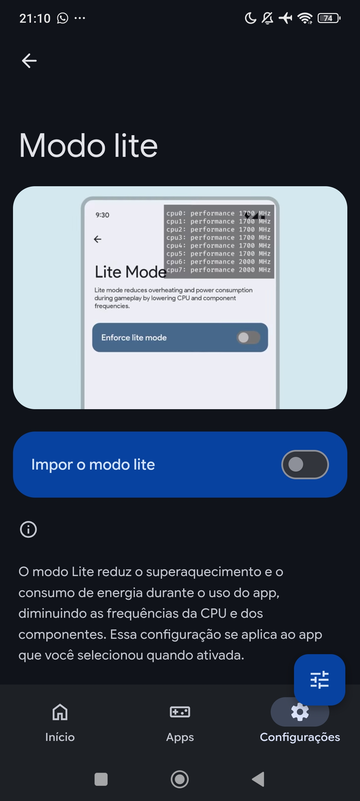
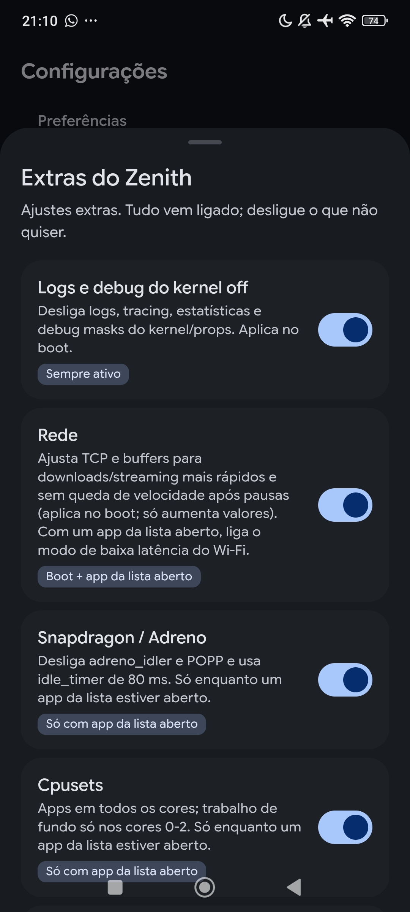
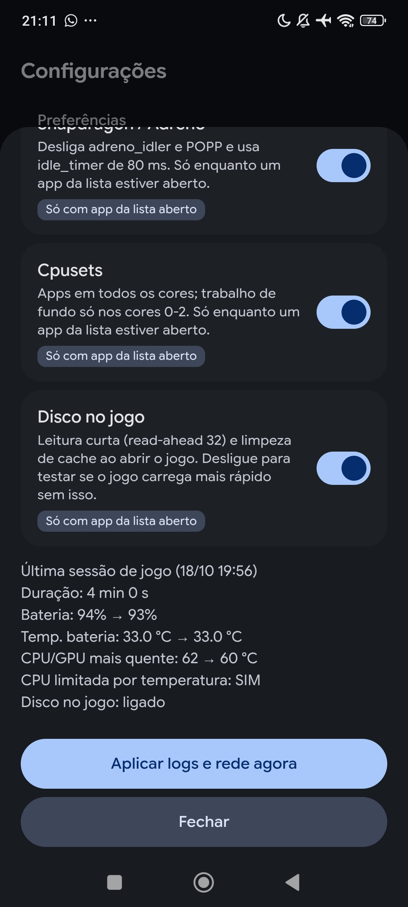
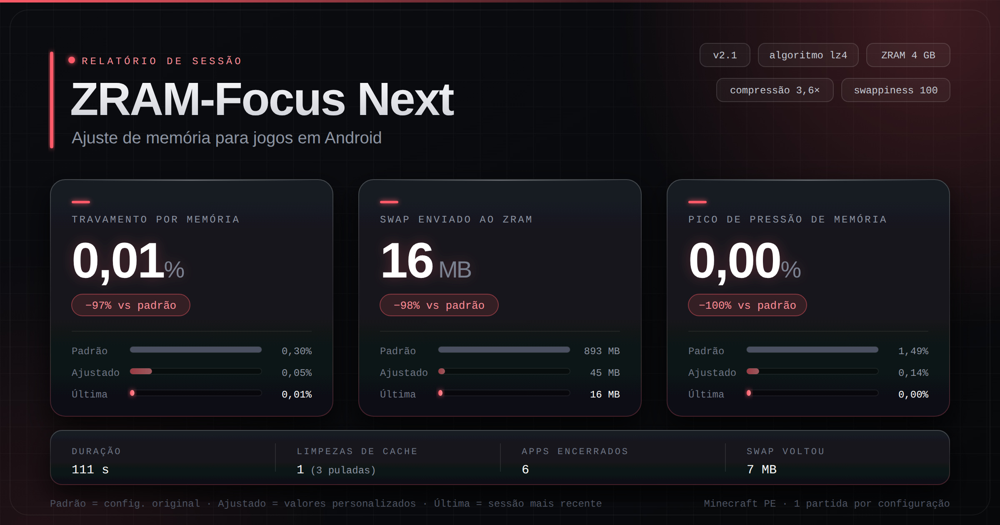

  

  

<h1 align="center">Keven · Engenheiro de software</h1>

  <strong>System Performance Researcher</strong> 
  Android Internals · Vendor Research · Magisk · AxManager · PC Optimization

  
  
  
  

  <a href="#sobre">Sobre</a> ·
  <a href="#coredroid">CoreDroid</a> ·
  <a href="#pesquisa">Pesquisa</a> ·
  <a href="#pc">PC Packs</a> ·
  <a href="#minecraft">Minecraft</a>

---

## Sobre

Comecei em otimização por necessidade: meu aparelho tinha que rodar melhor e ninguém tinha a resposta. Hoje estudo como cada fabricante cria sistemas internos, funções e muito mais.

Pesquiso o que fica escondido, meço de verdade e transformo em ajuste que funciona com ou sem root.

- **Device:** Poco X5 Pro (778G / Adreno 642L)
- **Foco:** MIUI / HyperOS, One UI, Motorola
- **Método:** Props via ADB + Shizuku, sem root + App e módulos Magisk / AxManager

---

## CoreDroid — v1.7 Stable

> 2 anos de desenvolvimento · App Android com 40+ ajustes via Shizuku, sem root. Performance, renderização, bateria e sistema numa única interface.

  
  

<b>Ver lista completa de recursos</b>

 

**Segurança e sistema:** Trava de Segurança (anti-reversão do Play Services), Core Repair, Partitions Trimmer, Core Shell
**Monitoramento:** Dashboard completo (SoC, GPU, RAM, bateria, kernel, uptime)
**Performance:** Core Mode, Turbo Sched, PerfMagic, Supressão térmica
**Renderização:** Render Preload (System, ANGLE, Native, Game Driver por app), Vulkan / OpenGL, SkiaVK / SkiaGL
**Tela e input:** Desbloqueador de FPS, anti burn-in, otimização de UI/launcher, touch e input lag
**Memória:** Limpeza, compressão de RAM, ZRAM/swap, ART / Dex2oat
**Outros:** Bateria (cache freeze, carga rápida), Rede (ping), Áudio (Surround, Hi-Fi), Core IA e Core Utils

> Aviso: recursos que removem limites térmicos exigem monitoramento.

<b>Complemento WebUI + Perfis por Fabricante</b>

 

**WebUI:** Ponte própria entre WebUI e Shizuku pra rodar ADB direto no app. Módulos: Driver Booster (SurfaceFlinger), Performance Fixa, Alta Prioridade, Limpador ART, Desativar Conexões Google.

**Xiaomi:** Performance Mode, cache, animações flagship, Game Turbo, vídeo e HDR
**Samsung:** Top App, remoção de telemetria e limites de FPS (recursos de S21 Ultra+)
**Motorola:** Parâmetros topo de linha, toque e CPU/GPU

---

## Pesquisa por Fabricante

- **Xiaomi / HyperOS:** Props `ro.*` / `persist.sys.*` via ADB sem root, blur e texturas em low-RAM, remoção de limitação de CPU, thermal
- **Samsung:** Modo Top App que limpa memória em uso pesado
- **Motorola:** Recursos extraídos de ROM topo de linha (áudio, toque, performance)

---

## Packs de PC

### Windows Pack - Completo
Pack extremamente completo que cobre tudo que um Windows precisa pra ter performance real. Sistema, jogos, rede, serviços e periféricos. Inclui otimização de mouse e teclado pra latência e resposta. Ganho médio de +40 FPS, podendo pegar mais dependendo do hardware, sem forçar PC no talo. Sem booster fake que só fecha processo.

### Linux Pack
Pack focado em performance desktop. Otimização de kernel (Liquorix), gerenciamento de memória, energia, bateria e sistema. Backup e limpeza do sistema, TLP, Swappiness, ZRAM, Preload e prevenção de erros.

---

## Minecraft

### KNBoost OPT-X Ultimate
Texture pack Bedrock focado em ganho de FPS. Mantém qualidade gráfica e chunks, sem deixar o jogo feio. FPS a mais com visual limpo.

### Newb X Dawn LITE (Otimizado)
Shader ultra otimizado e elegante pra aparelho intermediário. Versão que otimizei pra rodar liso em hardware fraco/médio, mantendo sombra e iluminação bonita sem pesar.

### KN-CraftTools
Ferramenta em Python pra modding de apks, com foco em otimização pra Minecraft Bedrock.

---

## Outros

### Módulos Magisk

#### Zenith Next (gráficos / CPU / rede)

  

  

#### ZRAM Focus Next (RAM / swap / armazenamento)

Focado em ZRAM, swap e limpeza de armazenamento pra manter RAM livre em uso pesado e jogos. Otimiza compressão e gerenciamento de memória.

  

### AxManager (sem root)
Frames, bateria, ram e armazenamento otimizados para extrair o máximo do dispositivo. Plugins específicos para Samsung e Xiaomi.

---

## Stack

  

---

## Stats

  
  

  

---

## Contato

  
  

  

